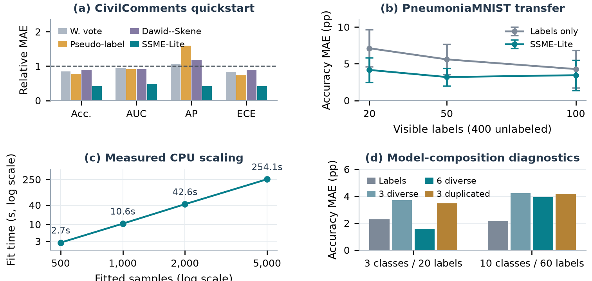

# SSME-Lite

**少量标签，多模型评估。一套可复现的预测、估计、选模与报告工作流。**

[](https://pypi.org/project/ssme-lite/)
[](pyproject.toml)
[](LICENSE)

SSME-Lite 将半监督模型评估方法封装为 sklearn 风格的 Python 工具包：输入多个模型的预测概率和少量已知标签，即可估计 Accuracy、ROC AUC、AP 与 ECE，生成模型排名、不确定性区间及可离线打开的交互报告。核心安装无需 PyTorch。

**作者：沈骏杰（Junje Shen） · 学号：2026211240 · 课程题目八**

[课程论文](report/main.pdf) · [中文导读](report/main_zh.md) · [实验成果](experiments/REPORT.md) · [复现指南](docs/reproduction.md) · [OpenI 项目](https://openi.pcl.ac.cn/jasonshen/SSME-Lite-2026211240)

## 先看成果

| 交付内容 | 核心能力与证据 | 阅读入口 |
| --- | --- | --- |
| 统一评估接口 | 概率矩阵生成、类别对齐、SSME 拟合、四指标估计与排名 | [API](docs/api.md) |
| 真实医学案例 | 七个预训练检查点 + 五个冻结 ResNet18 迁移分类头 | [主实验](experiments/REPORT.md) |
| 模型文件到报告 | JSON 配置、预检查、批量预测、输入哈希与离线输出 | [CLI 指南](docs/guides/cli.md) |
| 模型影响分析 | 逐模型移除后的后验敏感性，辅助理解模型组合 | [方法说明](docs/method.md) |
| 扩展实验 | 342 个配置：规模、并行、固定目标标签效率、多分类与重复预测 | [完整中文结果](experiments/extensions/RESULTS.md) |
| 可验证交付 | 48 项测试通过；源码与 wheel 安装验证；独立结果审计 | [验证记录](experiments/extensions/validation.json) |



**主实验：**20 个可见标签、十次共享划分下，准确率估计 MAE 从 **5.70 降至 2.22 个百分点**（七个检查点），从 **7.11 降至 4.16 个百分点**（五个迁移分类头）。十二个候选模型的平均准确率估计误差均降低。

**固定目标扩展：**另用 30 个种子固定 420 行样本池与 204 行留出集，在相同的 20 标签预算下，两组平均误差分别降低 **45.1% / 37.3%**。两套协议分别汇总，便于核验。

**工程验证：**完成 500–5,000 样本的 CPU 基准；5,000 样本、三个模型、两类、100 次更新的平均拟合时间为 **254.07 秒**。已测并行和分批配置的输出最大绝对差为 **0.0**。配置、环境、原始结果和源码快照均随仓库提供。

## 五分钟运行

为使用本次提交的全部功能，请从当前源码安装（Python 3.10+）：

```bash
git clone https://openi.pcl.ac.cn/jasonshen/SSME-Lite-2026211240.git ssme-lite
cd ssme-lite
python -m pip install -e '.[dev]'
python examples/quickstart.py
```

打开 `results/quickstart/report.html` 即可查看离线报告。已发布的基础版本也可通过 `python -m pip install ssme-lite==0.1.0` 安装；本次模型文件 CLI 和扩展实验随当前源码提供。

### 用已有模型一键生成报告

以下示例准备两个已训练分类器、评估特征与部分标签，然后通过 JSON 配置运行：

```bash
python examples/model_files.py
ssme-lite check-config results/model_files/config.json
ssme-lite results/model_files/config.json --trust-model-files
```

在自己的配置中指定模型文件、NPZ 数据、类别顺序和输出目录即可复用。joblib 文件需来自可信来源，加载时以 `--trust-model-files` 显式确认。已有的 `ssme-lite config.json` 调用保持兼容。

### Python 接口

```python
from ssme_lite import SSMEEstimator

# scores: (样本数, 模型数)，二分类正类概率
# y_partial: 已知类别；未知标签记为 -1
estimator = SSMEEstimator(max_iter=100, random_state=0)
estimator.fit(scores, y_partial, model_names=model_names)
report = estimator.report(primary_metric="accuracy")
print(report.ranking("accuracy"))
report.save("results/my_report")
```

多分类输入使用 `(样本数, 模型数, 类别数)`；标签为 `0..K-1` 的类别索引，每一类至少有一个可见标签。区间描述给定拟合后验下的标签不确定性；模型贡献度表示移除一个输入模型后的敏感性。详见[方法与解释](docs/method.md)。

## 目录导航

| 目录 | 用途 |
| --- | --- |
| `report/` | 最终论文 PDF、LaTeX、矢量图、中文导读、Overleaf 源码包 |
| `ssme_lite/` | 可安装的核心 Python 包 |
| `examples/` | 无外部数据的快速示例与模型文件工作流 |
| `docs/` | 安装、接口、教程、CLI、复现与方法说明 |
| `reproduction/` | 主实验的冻结输入、哈希、参考结果与复现脚本 |
| `experiments/` | 医学、迁移、CivilComments 与扩展实验资料 |
| `tests/` | 数值、接口、输入对齐、报告与实验协议测试 |

## 复现与验证

主实验从随仓库保存的预测开始，重新拟合 SSME，无需 GPU：

```bash
python reproduction/run.py --jobs 2
```

扩展结果可直接审计；图表可从已有统计记录重建：

```bash
python experiments/extensions/audit_results.py
python report/build_report.py
python report/build_extensions.py
python -m pytest -q
```

需要重新运行全部扩展或扩展至 10,000 样本时，参见[实验命令](experiments/extensions/README.md)。[复现指南](docs/reproduction.md)另列原图推理、ResNet18 特征提取和 CivilComments 输入准备步骤。

## 文档与引用

[文档首页](docs/index.md) · [输入格式](docs/guides/inputs.md) · [阅读报告](docs/guides/reports.md) · [迁移学习](docs/tutorials/transfer.md) · [课程要求对应](docs/course-requirements.md) · [贡献指南](CONTRIBUTING.md)

方法基于 Shanmugam 等人的 *Evaluating Multiple Models Using Labeled and Unlabeled Data*（NeurIPS 2025）。使用时请引用原论文；完整文献见 [references.bib](report/references.bib)。本项目采用 [MIT License](LICENSE)。
