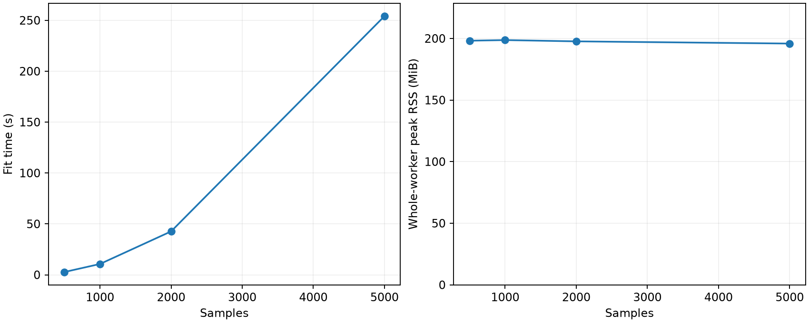
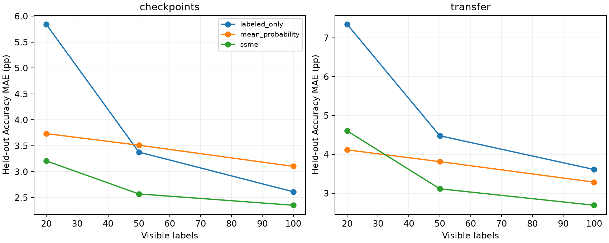
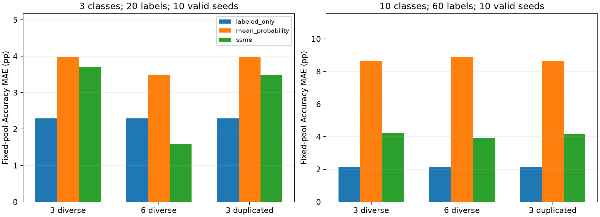

# SSME-Lite 扩展成果报告 — 2026-10-11

本次选定的四项扩展均已实现，全部位于最终提交目录 `ssme-lite` 内。完整实验共完成 **342 个独立进程实验配置**：42 个性能配置、180 个标签效率配置、120 个压力测试配置。没有实验进程崩溃或超时。压力测试中有 27 次 SSME 拟合因可见标签缺少类别而未执行，已明确记录为方法失败，不能计入成功拟合次数。

模型文件到报告的命令行示例也已运行成功，生成了[可离线查看的报告](model_cli_demo/report/report.html)。本轮实验无需使用服务器；另已提供 10,000 样本的服务器实验配置，但尚未运行。

## 1. 规模与并行基准

每个配置使用三个独立进程重复测量，固定执行 100 次更新，并将底层数值库线程数限制为 1。实验环境为 macOS 26.6 arm64、10 个逻辑 CPU、Python 3.11.16、NumPy 2.4.6、SciPy 1.17.1、pandas 2.3.3、scikit-learn 1.9.1、joblib 1.6.0。

下表使用可控的、相互重叠的高斯分数分布，包含三个模型、两个类别；KDE 使用一个工作线程，后验推断批大小为 512 行。

| 拟合样本数 | 平均拟合时间（秒） | 整个实验进程的平均峰值内存 RSS（MiB） |
| ---: | ---: | ---: |
| 500 | 2.73 | 198.18 |
| 1,000 | 10.62 | 198.69 |
| 2,000 | 42.63 | 197.65 |
| 5,000 | 254.07 | 195.85 |

在已测试范围内，耗时接近随样本量的平方增长。这些规模下，RSS 主要受库加载和报告生成等固定开销影响；表中的小幅下降属于进程测量波动，不能解释为样本越多越省内存。输入、类别后验概率和 KDE 训练点仍需保存在内存中，因此目前不能声称支持超出内存的数据处理或任意规模的数据。

在 1,000 行样本上，将类别拟合工作线程从一个增加到两个，平均拟合时间从 10.62 秒增加到 11.56 秒。在包含七个模型、624 行真实检查点预测的数据上，一个和两个工作线程分别耗时 3.88 秒、5.20 秒。这些场景中，线程开销超过了并行收益。

在 1,000 行样本上，将批大小从 512 改为 128，耗时为 10.74 秒。同样使用 1,000 行样本和三个模型，将类别数增加到五类，耗时为 27.10 秒；使用六个模型、两个类别时，耗时为 11.56 秒。

模型预测耗时另行测量：使用三个已训练的 sklearn 分类器、20 个特征，在 5,000 行评估样本上，一个和两个工作线程分别耗时 0.0173 秒、0.1305 秒。由于这些模型预测成本较低，虽然功能上支持并行，但不能据此宣传预测加速。

**所有已记录的工作线程数、批大小和重复运行对照中，输出的最大绝对差均为 0.0。** 指标计算、后验推断和报告生成分别计时。原始记录与汇总见：
[逐次运行结果](results/performance/full/per_run.csv)、
[汇总表](results/performance/full/summary.csv)、
[输出一致性对照](results/performance/full/equivalence.csv)、
[实验清单](results/performance/full/manifest.json)。

## 2. 从模型文件一键生成报告

当前源码支持 `source: "models"`：可配置带名称的可信 joblib 模型文件、NPZ 格式的评估特征和部分标签，并显式指定类别顺序。新增了配置预检查和分批预测；`init-config` 可生成配置模板，原有的 `ssme-lite config.json` 调用方式继续可用。命令行流程评估已经训练好的模型，不负责训练模型。

随项目提交的示例使用独立的训练样本训练模型，仅向评估流程提供 20 个可见标签。输出包括 HTML、CSV、JSON、固定保存的预测结果，以及输入数据和模型文件的 SHA256 哈希，便于追溯来源。

测试将该流程的预测概率和指标估计结果与直接调用 Python 接口的结果进行比较，也覆盖了从不同工作目录启动的情况。类别顺序错误和未经显式信任的模型加载会被拒绝；NumPy、pandas 和稀疏矩阵的分批预测结果均与整批预测一致。

可查看[示例配置](model_cli_demo/config.json)、[输入来源记录](model_cli_demo/report/input_provenance.json)和[命令行使用指南](../../docs/guides/cli.md)。

## 3. 固定评价目标下的标签效率

两个随项目提供的医学模型流程各使用 30 个新随机种子（100–129）。每个种子固定划分 420 行估计样本池和与其不重叠的 204 行留出集；20、50、100 个可见标签采用嵌套抽取，即较小标签集合包含在较大集合中。真实评价目标和拟合样本池均不随标签预算变化。

Accuracy 的 MAE 指“准确率估计值与真实准确率之间的平均绝对误差”：先在每个种子内对候选模型取平均，再对种子取平均。数值越小，估计越准确。全部 180 个配置均成功完成 SSME 拟合。下表单位为**百分点**，例如 3.21 表示准确率估计平均偏差约为 3.21 个百分点。

| 模型流程 | 仅用标签，20 个 | SSME，20 个 | 平均预测概率基线，20 个 | 仅用标签，50 个 | 仅用标签，100 个 |
| --- | ---: | ---: | ---: | ---: | ---: |
| 七个训练检查点 | 5.84 | 3.21 | 3.73 | 3.38 | 2.61 |
| 五个迁移学习分类头 | 7.35 | 4.60 | 4.11 | 4.48 | 3.61 |

在同样只有 20 个标签的条件下，SSME 相对于仅用标签的估计方法，平均误差分别降低约 **45.1% 和 37.3%**。

检查点流程中，SSME 使用 20 个标签的平均结果接近仅用 50 个标签，但仅凭均值接近，不能证明可以替代。对“SSME 使用 20 个标签的误差，减去仅用 50 个标签的误差”进行配对比较后，经过 Bonferroni 多重比较校正的单侧上界分别为 **+0.97 个百分点**（检查点）和 **+1.95 个百分点**（迁移学习），均未满足预先规定的“小于零”判据。六项预先规定的比较均未在校正后证明误差更低。

因此，**本次实验不足以支持“节省 60% 标签”的结论**，也没有证明两种方法等效；这同样不意味着其他实验条件下不存在收益。

平均预测概率基线也具有竞争力，在迁移学习分类头上尤其明显。检查点流程中，基于留出集真值衡量的最优模型选中率，从仅用 20 个标签的 38.4% 提升到 SSME 的 63.3%；所选模型相对真正最优模型的准确率损失，从 1.68 降至 0.60 个百分点。迁移学习流程中，最优模型选中率从 25.1% 提升到 40.0%，但平均预测概率基线达到 46.7%。因此，指标估计误差和模型选择质量应分别报告。

本轮使用新的随机种子和固定评价目标设计，未覆盖或替换原稿的 10 次划分结果，也不应将两者视为相同实验的数值复现。详细证据见：
[汇总表](results/labels/full/summary.csv)、
[配对比较](results/labels/full/paired_comparisons.csv)、
[数据划分审计](results/labels/full/audit.json)、
[逐种子结果](results/labels/full/per_seed.csv)。

## 4. 多分类与模型组合诊断

在 sklearn digits 数据集的训练划分上训练六个分类器，保存三分类和十分类的固定预测概率，并附带训练、评估样本编号以及模型配置。所有输入方案都只评估**相同的三个原始候选模型**，额外模型仅用于给 SSME 提供辅助预测信息，以保证比较目标一致。

下表为固定样本池上的准确率估计 MAE，单位为百分点，越小越好。“三个模型各重复一次”指将原有三个模型的预测各复制一份，形成六组输入。

| 类别数 / 可见标签数 | 仅用标签 | SSME：三个不同模型 | SSME：六个不同模型 | SSME：三个模型各重复一次 | 每种 SSME 方案的有效种子数 |
| --- | ---: | ---: | ---: | ---: | ---: |
| 3 / 20 | 2.29 | 3.69 | 1.59 | 3.48 | 10/10 |
| 3 / 60 | 1.40 | 2.78 | 1.39 | 2.67 | 10/10 |
| 10 / 60 | 2.13 | 4.22 | 3.93 | 4.17 | 10/10 |

十分类且仅随机观察 20 个标签时，**10 个标签抽样中有 9 个缺少至少一个类别**，三个输入方案均受到影响，共产生 27 次方法失败。每个方案仅剩一个种子可估计，因此未将其 SSME 均值与包含十个种子的基线直接比较。原始数值和缺失类别状态均保留在结果文件中；AUC 无法定义的情况也原样记录，没有补值或人为修补标签。

三分类结果表明，增加不同模型的辅助预测与简单重复已有预测具有不同效果：20 个标签时，六个不同模型相较三个模型，将 MAE 降低 2.11 个百分点；精确复制已有模型仅降低 0.22 个百分点。这些数值是十个标签抽样上的配对均值，属于描述性结果，不能保证在其他任务上同样有效。

重复预测没有增加新信息，但会改变加性对数比变换（ALR）后的空间几何关系和 Scott 带宽，因此估计结果不一定对重复输入保持不变。

十分类、60 个标签的结果揭示了明确的失败场景：所有 SSME 输入方案的准确率估计 MAE 均高于仅用标签的基线。这验证了多分类输入功能能够运行，但未证明其在多分类任务中能稳定提高估计准确性。压力测试的主要评价目标为固定的 240 行样本池；三分类的独立留出集仅有 29 行，只作为有限的补充证据。

详细证据见：
[汇总表](results/stress/full/summary.csv)、
[方法运行状态](results/stress/full/status.csv)、
[输入方案的配对效果](results/stress/full/regime_pairs.csv)、
[诊断信息](results/stress/full/diagnostics.csv)、
[固定输入清单](inputs/digits_manifest.json)。

## 5. 验证结果与适用范围

- 源码目录测试：**48 项通过，1 项可选的官方审计测试跳过**。
- 在仓库外运行的已安装 wheel 包测试：**48 项通过，1 项跳过**。
- MkDocs 严格构建和 twine 严格安装包检查均通过。
- 独立审计通过：核对了 342 个原始配置、2,358 行统计结果、8,478 个准确率真值、72 个源码快照文件，以及全部 27 次缺失类别判定。详见[审计记录](results/audit_full.json)。
- 已检查原始结果哈希、固定评价目标、互不重叠的数据划分、嵌套标签集合，以及并行和分批结果的一致性。
- 本轮为尚未发布的源码扩展，未发布新的 PyPI 版本，也未据此修改原稿结论。
- 实测 5,000 行样本的拟合约耗时 4.2 分钟。按近似平方增长粗略外推，同一机器上 10,000 行样本单次拟合约需 17 分钟；这是估算值，并非实测结果。如需该规模，可使用已准备的 CPU 服务器实验配置。

复现命令和断点续跑规则见[复现说明](README.md)。分析代码的来源记录与不可修改的测量源码快照分开保存。最终压力测试图展示三分类 / 20 个标签和十分类 / 60 个标签，使图中每种方法均包含十个有效种子；失败较多的十分类 / 20 个标签结果仍完整保留在表格中。
