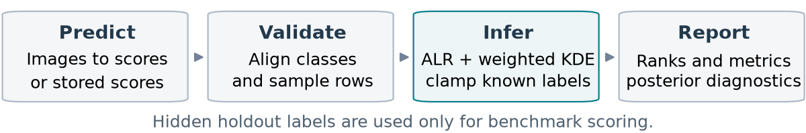
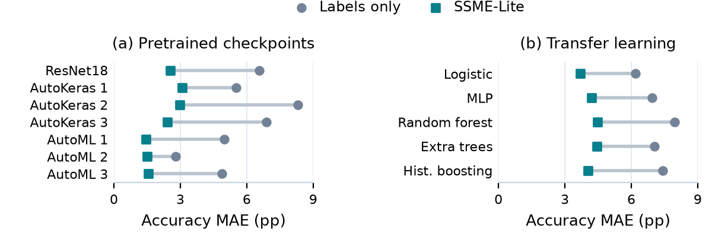

# SSME-Lite：小样本模型评估的可复现工具链

**沈骏杰 / Junje Shen · 学号 2026211240**

本文是[正式课程论文](main.pdf)的中文导读。论文采用 JMLR 格式，按“问题与方法—软件实现—主实验—扩展验证”展开；参考文献和复现附录单独编排。

## 1. 项目解决什么问题

医疗影像等任务中，已有多个训练好的模型，但人工标签数量有限。SSME-Lite 结合少量已知标签与大量未标注样本上的模型预测，估计每个模型的准确率、AUC、平均精确率与校准误差，并生成排名、区间和模型影响分析。

项目的核心贡献是完整且可复用的工程流程：**预测概率生成 → 类别与样本对齐 → 半监督评估 → 模型选择 → 离线报告**。核心包采用 sklearn 风格接口，无需安装深度学习框架；迁移学习作为可选示例接入。

## 2. 怎样实现

将多个模型的类别概率转为加性对数比特征，通过带权核密度估计迭代更新类别后验，已知标签在迭代中固定。准确率通过后验期望计算；AUC、AP、ECE 使用共享的后验标签抽样，使模型间对照保持一致。

Python 用户通过 `fit()` 和 `report()` 完成评估；命令行用户在 JSON 中指定模型文件、评估数据、类别顺序与输出目录，即可从已训练模型生成 HTML、CSV、JSON 和图表。配置预检查、输入哈希、冻结预测和实验清单使每份报告能够追溯到输入。

并行预测、按类别拟合与分批后验推断提供可配置执行方式。模型影响分析逐个移除输入模型，在固定设置下比较后验变化，帮助理解哪些预测来源对评估更有影响。

## 3. 医学主实验：十二个候选模型

PneumoniaMNIST 主实验包含七个已发布检查点，以及在冻结 ResNet18 特征上训练的五个分类头。每次划分提供 20 个标签、400 个未标注样本，另留 204 个样本作为独立评价目标，共使用十次共享划分。

| 实验组 | 仅用标签的准确率估计 MAE | SSME-Lite MAE | 平均误差下降 |
| --- | ---: | ---: | ---: |
| 七个预训练检查点 | 5.70 个百分点 | 2.22 个百分点 | 61.1% |
| 五个迁移分类头 | 7.11 个百分点 | 4.16 个百分点 | 41.4% |

十二个候选模型的平均准确率估计误差均降低。以准确率为目标的最优模型选中率，分别从 23.3% 提高到 50.0%、从 25.0% 提高到 70.0%。完整四指标结果、配对区间和逐模型记录均随项目保存。

CivilComments 提供原论文数据上的快速入门与定性复现：50 次有效划分中，Accuracy、AUC、AP、ECE 的误差相对于仅用标签分别为 0.41、0.47、0.42、0.42，另保存投票、伪标签及 Dawid–Skene 对照。

## 4. 扩展验证：342 个配置

**固定评价目标的标签效率。** 两组医学流程各使用 30 个新种子。每个种子的 420 行样本池和 204 行留出集固定，20、50、100 标签嵌套抽取，形成 180 个配置。在相同的 20 标签预算下，两组平均误差分别从 5.84 降到 3.21 个百分点、从 7.35 降到 4.60 个百分点，相对降低 45.1% 和 37.3%。该扩展实验的完整统计保留在实验报告中。论文图 3a 恢复 CivilComments 的四指标相对误差对比；图 3b 恢复原迁移学习实验在 20、50、100 标签下的误差曲线与 95% t 区间（每个预算 10 次划分，400 个无标签样本，留出集分别为 204、174、124 行）。

这组结果支持“相同标签预算下的估计收益”；跨预算替代采用单独的统计判据，具体记录见[完整实验结果](../experiments/extensions/RESULTS.md)。新协议与原十次划分主实验分别汇总。

**CPU 规模与执行一致性。** 42 个性能配置测量拟合、推断、指标、报告和预测耗时。在三个模型、两个类别、100 次更新下，500、1,000、2,000、5,000 样本的平均拟合时间为 2.73、10.62、42.63、254.07 秒。每组使用三个独立进程重复，保存机器与依赖信息。已测并行和分批配置的最大输出差为 0.0；工作线程数可按实际任务选择。

**多分类与模型组合。** 120 个配置覆盖三分类、十分类、不同模型和重复预测输入。每个方案始终评估相同的三个候选模型。三分类、20 标签时，六个不同模型提供辅助预测后的 MAE 为 1.59 个百分点；三个模型和复制已有预测分别为 3.69、3.48。该对照说明，模型数量之外，预测信息的组成值得单独考察。图中展示十个种子均覆盖全部类别的两个设置；完整配置、类别覆盖与评价状态可从原始记录核验。

## 5. 可以直接审阅和复现的交付

- **论文与图表：**正式 PDF、可编辑 LaTeX、矢量 PDF 图、高清 PNG、图表生成脚本及输入哈希。
- **工具包：**统一 API、模型文件 CLI、离线交互报告、安装与教程；基础版本已发布到 PyPI。
- **实验：**冻结预测、模型配置、固定数据划分、逐次结果、汇总、源码快照与审计记录。
- **验证：**源码及已安装 wheel 均通过 48 项测试；独立审计核对 342 个配置、2,358 行统计结果、8,478 个准确率真值。

从仓库根目录运行 `python reproduction/run.py --jobs 2` 可重新拟合医学主实验。扩展实验和服务器配置见[复现命令](../experiments/extensions/README.md)，审计可运行 `python experiments/extensions/audit_results.py`。所有最终材料均在 `ssme-lite` 目录内。
